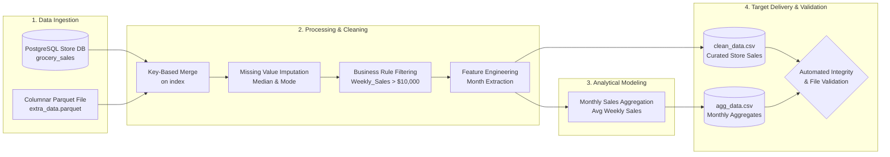

# Retail Data Pipeline: Holiday Demand & Sales Analysis

An end-to-end Extract, Transform, Load (ETL) data pipeline designed to ingest, clean, and analyze multi-source retail sales data across Walmart store departments. The pipeline evaluates the impact of holiday seasonality, promotional markdowns, and macroeconomic indicators (CPI, unemployment rate, fuel prices) on sales performance.

---

## Architecture Overview

The pipeline ingests heterogeneous data from an operational PostgreSQL relational database and an external Parquet columnar storage file, unifies them on a surrogate index key, performs data cleaning and feature engineering, and writes validated curated datasets for downstream business intelligence and reporting.



---

## Data Sources & Schema Design

The pipeline integrates two distinct sources representing operational transactional records and environmental context:

### 1. `grocery_sales` (Relational Database)
Contains primary weekly store sales transactions:
* `index` (*integer*): Surrogate row identifier.
* `Store_ID` (*integer*): Unique identifier for each retail store.
* `Date` (*string / date*): Date corresponding to the end of the sales week.
* `Dept` (*integer*): Department number within the store.
* `Weekly_Sales` (*float*): Total sales for the department in the specified week.

### 2. `extra_data.parquet` (Columnar Storage)
Stores environmental, promotional, and macroeconomic telemetry:
* `index` (*integer*): Surrogate join key corresponding to transactional records.
* `IsHoliday` (*integer*): Flag indicating whether the sales week contains a major national holiday (`1` = Holiday, `0` = Regular).
* `Temperature` (*float*): Regional ambient temperature during the sales week.
* `Fuel_Price` (*float*): Regional fuel price index.
* `MarkDown1` - `MarkDown5` (*float*): Anonymized promotional markdowns applied across store departments.
* `CPI` (*float*): Prevailing Consumer Price Index.
* `Unemployment` (*float*): Regional unemployment rate.
* `Size` (*float*): Physical store footprint size.
* `Type` (*float / category*): Store type tier (categorized primarily by size and catalog depth).

---

## Pipeline Stages

### 1. Extraction (`extract`)
* Reads columnar Parquet files using Apache Arrow / PyArrow engines.
* Executes SQL queries against the operational store database (`SELECT * FROM grocery_sales`).
* Merges datasets on the surrogate `index` key, creating an enriched transactional dataset of over 230,000 records.

### 2. Transformation & Cleaning (`transform`)
* **Skewed Numerical Imputation**: Imputes missing values in financial and macroeconomic columns (`Weekly_Sales`, `MarkDown4`, `MarkDown5`, `CPI`, `Unemployment`, `Size`) using the **median** rather than the mean to prevent distortion from extreme outliers.
* **Categorical Imputation**: Fills missing store category classifications (`Type`) using the **mode**.
* **Temporal Parsing**: Converts raw date strings to native datetime format and parses a dedicated calendar `Month` feature for seasonal analysis.
* **Quality Filtering**: Enforces business validity by removing null date records and filtering records where `Weekly_Sales > 10000` (eliminating negative sales anomalies, returns, and low-volume edge cases).
* **Dimensional Pruning**: Projects the dataset to the required analytical dimensions (`Store_ID`, `Month`, `Dept`, `IsHoliday`, `Weekly_Sales`, `CPI`, `Unemployment`) to optimize downstream memory and storage footprint.

### 3. Aggregation (`avg_weekly_sales_per_month`)
* Computes benchmark monthly average weekly sales figures:
  $$\text{Avg\_Sales} = \frac{1}{N} \sum \text{Weekly\_Sales}$$
* Rounds monetary aggregates to 2 decimal places for financial reporting consistency.

### 4. Loading & Verification (`load`, `validation`)
* Persists clean records to `clean_data.csv` and the summary model to `agg_data.csv`.
* Executes an automated post-load check verifying file existence and non-empty status before reporting success.

---

## Analytical Findings: Monthly Sales Trend

Aggregated monthly performance reveals clear seasonal demand cycles driven by major shopping events:

| Month | Avg Weekly Sales ($) | Key Seasonal Driver |
| :---: | :---: | :--- |
| **1** | $33,174.18 | Post-holiday slowdown, inventory clearance |
| **2** | $34,342.44 | Super Bowl weekend demand |
| **3** | $33,227.31 | Spring baseline sales |
| **4** | $33,414.78 | Easter / Spring promotions |
| **5** | $33,339.89 | Memorial Day weekend ramp-up |
| **6** | $34,582.47 | Summer season launch |
| **7** | $33,930.77 | Mid-summer baseline |
| **8** | $33,644.79 | Back-to-school preparations |
| **9** | $33,266.59 | Labor Day weekend promotions |
| **10** | $32,736.99 | Pre-holiday dip (lowest average month) |
| **11** | **$36,594.03** | Thanksgiving & Black Friday surge |
| **12** | **$39,248.98** | Christmas & Holiday peak season |

*Observation*: Q4 represents the peak revenue window, with December generating an **~18% increase** in average weekly sales compared to the annual low in October.

---

## Project Structure

```text
├── notebook.ipynb         # Interactive Jupyter notebook containing pipeline code & EDA
├── agg_data.csv           # Target artifact: monthly aggregated sales metrics
├── extra_data.parquet     # Source: complementary store & macroeconomic attributes
├── walmartecomm.jpg       # Contextual documentation asset
├── requirements.txt       # Project dependencies (Pandas, PyArrow, Jupyter)
├── .gitignore             # Standardized git ignores (virtualenvs, checkpoints, caches)
└── README.md              # Project documentation and architecture guide
```

---

## Getting Started

### Prerequisites
* Python 3.9+ installed
* Pip or Conda package manager

### Installation
1. Clone the repository:
   ```bash
   git clone https://github.com/7efnawi/Building-a-Retail-Data-Pipeline.git
   cd Building-a-Retail-Data-Pipeline
   ```

2. Create and activate a virtual environment:
   ```bash
   # On macOS/Linux
   python3 -m venv venv
   source venv/bin/activate

   # On Windows (PowerShell)
   python -m venv venv
   .\venv\Scripts\Activate.ps1
   ```

3. Install required dependencies:
   ```bash
   pip install -r requirements.txt
   ```

4. Launch the notebook:
   ```bash
   jupyter notebook notebook.ipynb
   ```

---

## Production Roadmap & Improvements

To transition this single-node pipeline into an enterprise-grade production workflow:

1. **Orchestration**: Transition execution from a Jupyter notebook to an orchestrator like **Apache Airflow** or **Dagster** for scheduled DAG runs, retries, and alert notifications.
2. **Compute Scalability**: Replace in-memory Pandas operations with **Polars** or **DuckDB** for local high-throughput processing, or **PySpark** when handling multi-terabyte transactional datasets.
3. **Data Quality Contracts**: Implement validation frameworks such as **Great Expectations** or **Soda Core** to validate schema conformance, null constraints, and value thresholds prior to loading.
4. **Cloud Warehouse Integration**: Load curated layers into a cloud data warehouse (Snowflake, BigQuery, or Databricks Delta Lake) partitioned by `Date` and clustered by `Store_ID`.
